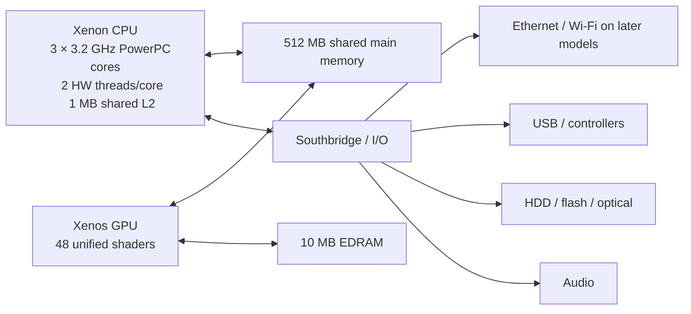
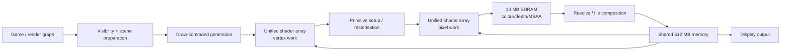
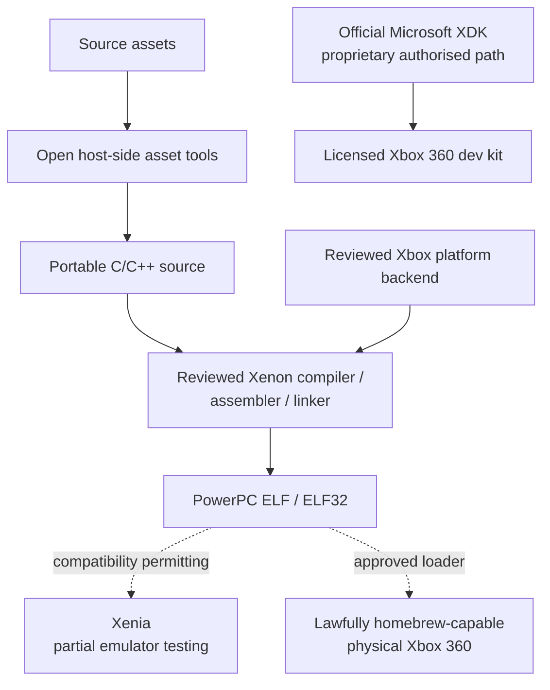

# Xbox 360 Development with Legal, Non-Proprietary Tooling

## Executive summary

This report assesses the Xbox 360 development landscape as of **15 September 2026**, with a deliberately strict distinction between software that is merely obtainable, software that is open source, software that is permissively licensed, and software that Microsoft historically supplied only under proprietary developer agreements.

The central conclusion is important: **there is no currently identifiable, end-to-end, production-grade Xbox 360 SDK that is both fully open/permissively licensed and cleanly auditable from source to hardware deployment**. The official Microsoft Xbox 360 XDK remains proprietary and historically confidential; XNA Game Studio 4.0 was publicly downloadable but is governed by Microsoft licence terms rather than an open-source licence; and the principal community native SDK, LibXenon, is technically useful but, as of 2026, does **not have a clearly established top-level licence in its current repository**—indeed, an open 2026 issue asks the maintainers to clarify precisely that point. citeturn6search7turn21search11turn18search0

That does **not** mean legal Xbox 360 research or homebrew development is impossible. A substantial portion of the toolchain can be assembled from lawful free/open-source components: GCC, GNU Binutils, Newlib, zlib, libpng, FreeType and similar software; the Free60 toolchain builds a Xenon-targeted GCC/Binutils/Newlib cross-compiler; and the Xenia emulator is open source under the BSD 3-Clause licence. The current Free60 build script explicitly pulls Binutils 2.32, GCC 9.2.0 and Newlib 3.1.0 and builds them for the `xenon` target. citeturn26view2turn17view2

The licensing boundary is therefore best represented as follows:

| Development element | 2026 assessment | Suitable for a strict non-proprietary baseline? |
|---|---|---|
| GCC / Binutils / Newlib cross-toolchain | Free/open-source; partly copyleft, Newlib largely permissive | **Yes, subject to normal licence compliance** |
| LLVM/Clang host/compiler research | Apache-2.0 with LLVM exception; PowerPC backend exists | **Yes**, but no complete Xbox 360/Xenon ABI + VMX128 + runtime solution is supplied upstream citeturn36search0turn36search5 |
| zlib / libpng / FreeType | Permissive or permissive-option licences | **Yes** citeturn30search0turn30search1turn30search2 |
| Xenia | BSD-3-Clause emulator | **Yes**, for emulation/research; not a hardware SDK citeturn4view2turn17view2 |
| Free60 Xenon toolchain script | Script itself explicitly states public-domain status | **Yes for that file**, but audit patches and bundled ports separately citeturn26view2 |
| LibXenon | Bare-metal Xbox 360 homebrew runtime, but current overall licence unclear | **No, not without licence clarification/audit** citeturn26view0turn18search0 |
| XeLL Reloaded | Useful homebrew loader; current-fork licence should be independently audited | **Not as a default compliance baseline** citeturn4view1 |
| XNA Game Studio 4.0 | Microsoft proprietary freeware/EULA | **No** under a permissive-only requirement citeturn6search15turn6search7 |
| Xbox 360 XDK | Microsoft proprietary/confidential developer kit | **No**, unless legitimately licensed by Microsoft under the relevant developer agreement citeturn21search11 |

There is a second, separate obstacle: **deployment**. An unmodified retail Xbox 360 does not provide a public mechanism for executing arbitrary newly built native unsigned binaries. Historically, XNA provided an authorised retail-console development route, and licensed developers used Microsoft XDK hardware/software, but those are not current, open, permissively licensed deployment channels. The Xbox 360 Marketplace itself ceased new purchases on **29 July 2024**. citeturn14search1turn6search15

For a new engineering project, the soundest architecture is therefore a **portable C/C++ engine with a very narrow Xbox platform abstraction**, keeping almost all game code, asset tooling, tests and simulation on ordinary PCs under licences you control. The Xbox-specific backend should be treated as an independently audited component. This preserves the option of using a clean-room backend later, an authorised XDK if one is lawfully available, or an audited homebrew runtime without contaminating the engine core.

The engineering target itself remains attractive for low-level study. Microsoft's/IBM's published Xbox 360 silicon material documents three 3.2 GHz PowerPC CPU cores, two hardware threads per core, a shared 1 MB L2 cache, VMX128 vector facilities, a GPU with 48 unified shader processors and a high-speed interface to 10 MB of embedded DRAM; the 2010 integrated revision remained functionally compatible with earlier Xbox 360 CPU/GPU silicon. citeturn11view0turn10view0

The practical recommendation is therefore:

**Use open host-side tools and libraries freely; use Xenia for research and automated testing where it is compatible; isolate Xbox-specific code; do not use leaked Microsoft XDK material; do not treat LibXenon as permissively licensed until its licence is explicitly resolved; and deploy on physical homebrew hardware only when both the software licences and the legality of the console modification in the relevant jurisdiction have been established.**

## Platform baseline: hardware, firmware, filesystems and paths

Microsoft and IBM's Hot Chips material provides the strongest publicly available primary-source description of the Xbox 360 CPU/GPU design. The later single-chip implementation integrates the CPU and GPU while maintaining functional and performance compatibility with the earlier discrete architecture, making it useful as an official architectural reference for the platform generally. citeturn10view0turn11view0

| Component | Xbox 360 characteristics | Development consequence |
|---|---|---|
| CPU | Three PowerPC cores at **3.2 GHz**; two hardware threads per core; 32 KiB instruction + 32 KiB data L1 per core; shared **1 MB L2**; VMX128 vector unit | Six hardware contexts, but only three physical cores; optimise cache behaviour, scheduling and SIMD rather than assuming PC-style high single-thread IPC. citeturn11view0 |
| GPU | Custom Xenos GPU; **48 unified shader processors**; official presentation quotes up to 24 billion shader instructions/s, 4 billion pixels/s and 500 million triangles/s | Unified shader scheduling; highly bandwidth-conscious render architecture. citeturn11view0 |
| EDRAM | **10 MB** embedded DRAM connected to the GPU | Render-target/depth/MSAA footprint has to be planned explicitly; larger configurations require tiling. citeturn11view0turn11view1 |
| Main memory | **512 MB shared system memory**; production systems use GDDR3 | CPU, GPU assets, executable code and system overhead compete for a relatively small unified pool. citeturn11view1turn9search2 |
| Storage | DVD optical drive plus HDD/flash configurations varying by model; the Slim reference shown by Microsoft uses a **250 GB HDD** | Never bake assumptions about a specific HDD capacity into game logic. citeturn11view1 |
| I/O | Southbridge connects Ethernet, HDD, flash, audio, controller interfaces, optical drive, infrared and USB | Design the engine around asynchronous I/O and device abstraction. citeturn11view1 |
| Networking | Wired Ethernet across the family; the later 250 GB Slim architecture integrated **802.11n Wi-Fi** | Treat wireless availability as model-dependent rather than universal. citeturn11view1 |

A conceptual hardware model for the development document should look like this:



This arrangement follows Microsoft's published integrated-system block diagram; the main architectural fact to retain is that CPU and GPU share the main-memory resource while rendering also has the dedicated 10 MB EDRAM path. citeturn11view0turn11view1

**Firmware and operating system.** Xbox 360 system software is a proprietary Microsoft platform rather than a general-purpose user-programmable OS. Microsoft still maintains an Xbox 360 system-update support page. The last conventional public kernel/dashboard build widely documented is **2.0.17559.0**, released in November 2019. Microsoft nevertheless made later dashboard/service-side presentation changes: in June 2025 the dashboard was updated to correct distorted cover art and add Xbox Series promotional material. It is therefore more accurate to call 17559 the last widely documented **kernel/system build** than to claim that nothing on the dashboard has changed since 2019. citeturn29search2turn31search4turn31news8

A development document should not attempt to target undocumented dashboard internals. Official native applications historically relied on the XDK's supported platform interfaces; bare-metal homebrew instead interacts with the machine through its own runtime and loader. These are fundamentally different execution models and should never be mixed in architecture documentation.

**Executable formats are correspondingly different.** A licensed Microsoft title normally uses the Xbox executable/package mechanisms supplied by the XDK, whereas Free60/LibXenon builds conventionally produce PowerPC ELF output; the supplied Free60 rules convert the linked image to an `elf32-powerpc` file and the project's example produces a `.elf32` image intended to be run through XeLL. citeturn28view0turn28view1

**Filesystem.** The Xbox/Xbox 360 storage family uses FATX/XTAF-family storage rather than a conventional desktop NTFS installation. Free60 documents FATX as the filesystem used by Xbox/Xbox 360, while XeLL can access several formats depending on device and build, including FAT, ext2, ISO9660 and Xbox/XTAF-style storage. citeturn6search6turn4view1

Community documentation commonly represents retail content storage using a structure such as:

```text
Content\
└── 0000000000000000\
    └── <TitleID>\
        └── <ContentType>\
            └── <content packages>
```

and profile-associated data under a profile-ID directory rather than the all-zero public-content directory. This is useful when analysing lawfully owned storage, but it is a **reverse-engineered storage convention, not a public application API contract** and should not be used as the abstraction boundary of new homebrew software. citeturn23search1turn23search5

For new homebrew code, use a mount-agnostic abstraction such as:

```text
AppReadOnlyRoot/
    assets/
    shaders/
    localisation/

UserWritableRoot/
    save/
    config/
    cache/
    logs/
```

Resolve `AppReadOnlyRoot` and `UserWritableRoot` at launch through the selected platform backend instead of scattering strings such as HDD or USB mount names through game code. This also keeps the portable engine independent of whichever loader exposes the physical storage.

The development specification should treat these constraints as fixed:

| Constraint | Engineering rule |
|---|---|
| Only 512 MB shared memory | Establish explicit code, asset, streaming, audio and render-memory budgets. |
| 10 MB render EDRAM | Determine render-target/MSAA tiling strategy during renderer design, not at optimisation time. |
| Six hardware threads ≠ six full cores | Schedule around three physical cores and shared execution/cache resources. |
| Proprietary dashboard | No dependency on undocumented system UI internals. |
| Different retail/homebrew execution formats | Separate licensed-XDK, emulator and homebrew deployment descriptions. |
| Model-dependent storage/network devices | Feature-detect rather than infer from console model. |

## Toolchain, SDK and licence inventory

The most useful community-native toolchain remains Free60's Xenon cross-compilation environment. Its current build script identifies `xenon` as the target and, at the time researched, downloads and patches **GNU Binutils 2.32, GCC 9.2.0 and Newlib 3.1.0**. GCC is built in two stages, ultimately enabling C and C++, Newlib is used as the C library, and the final GCC configuration explicitly disables general threading support. citeturn26view2

The script itself is unusually clear about its own provenance: its header says the original script was released to the public domain and that the Xbox modifications remained public domain. That statement applies to the script, however—not automatically to every patch, source file, runtime library and filesystem port that the surrounding repository may use. citeturn26view2

The distinction matters because **LibXenon itself cannot currently be recommended as a clearly permissive dependency**. Its README describes it as a bare-metal Xbox 360 homebrew library and provides build instructions, but the current repository has an open March 2026 issue specifically asking what licence applies because no clear overall licence is identified. Free60's historical documentation does state that LibXenon was intended to be developed without using Microsoft's existing code as its basis, which is relevant evidence of clean-room intent, but clean-room provenance and open-source licensing are two separate questions. citeturn26view0turn18search0turn3search4

A rigorous dependency inventory should therefore look like this:

| Component | Source | Licence status | Xbox 360 compatibility | Advantages | Limitations / compliance status |
|---|---|---|---|---|---|
| **Free60 Xenon toolchain build script** | Free60Project | Public domain according to file header | Builds the established `xenon` cross-toolchain | Reproducible bootstrap; Linux-oriented | Audit patches and downloaded components independently; script licence does not license the entire repository. citeturn26view2 |
| **GCC 9.2.0 as used by Free60** | GNU / Free60 patches | GPLv3+; GCC runtime libraries use the GCC Runtime Library Exception where applicable | Established Free60 compiler for Xenon | Mature optimiser; C/C++; PowerPC code generation | Copyleft tool, not permissive; old pinned version; Xbox-specific patches are additional audit surface. citeturn26view2turn24search4 |
| **GNU Binutils 2.32** | GNU / Free60 patches | GPL-family copyleft | Assembler, linker, `objcopy`, `strip`, `nm`, `objdump` for `xenon` target | Complete traditional embedded toolchain | Not permissive; old pinned version; patches must be retained/audited. citeturn26view2turn28view1 |
| **Newlib 3.1.0** | Sourceware | Component-specific predominantly permissive/BSD-like notices | C library used by Free60 bare-metal target | Appropriate for embedded/bare-metal environments | Must preserve component licence notices; not every file necessarily has an identical licence. citeturn26view2turn24search6 |
| **LLVM/Clang** | LLVM Project | Apache-2.0 with LLVM Exception | Upstream has a PowerPC target but no turnkey Xbox 360 runtime/ABI/VMX128 SDK | Modern optimiser, diagnostics, permissive licence | **Not** a drop-in replacement for Free60; substantial backend/runtime integration required. citeturn36search0turn36search5turn36search11 |
| **zlib** | zlib project | zlib licence, permissive | Free60's auxiliary build uses zlib 1.2.11 | Tiny, ubiquitous compression library | Free60's pinned version is old; update only after testing the port. citeturn26view2turn30search0 |
| **libpng** | libpng project | libpng permissive open-source licence | Free60 script ports 1.5.30 | Standard PNG decoding | Free60 version is far behind current upstream 1.6.x; asset parsers should be modernised where practical. citeturn26view2turn30search1 |
| **FreeType** | FreeType project | Choice of FreeType License or GPLv2 | Free60 script ports 2.10.4 | Font rasterisation | Preserve attribution/licence requirements; test newer versions before replacing the port. citeturn26view2turn30search2 |
| **bzip2** | bzip2 project | Permissive bzip2 licence | Free60 script contains a port of 1.0.6 | Asset/archive decompression | Very old pinned version; probably unnecessary for many games. citeturn26view2 |
| **Xenia** | Xenia Project | BSD-3-Clause | Xbox 360 emulator/research platform | Excellent lawful host-side research tool; source available | Designed primarily around retail Xbox 360 software behaviour; not a complete substitute for real hardware or direct-hardware LibXenon testing. citeturn4view2turn17view2turn19search6 |
| **LibXenon** | Free60Project | **No clear current top-level licence identified** | Bare-metal native Xbox 360 runtime | Most relevant community hardware abstraction | **Do not call permissively licensed. Obtain clarification or conduct file-by-file audit before redistribution/commercial use.** citeturn26view0turn18search0 |
| **XeLL Reloaded** | community/Free60 ecosystem | Licence of the selected current fork must be verified | Loads homebrew ELF and Linux on suitable systems | Useful boot/deployment layer; TFTP, USB and other media support | Requires a homebrew-capable console; not an authorised retail publishing mechanism. citeturn4view1 |
| **XNA Game Studio 4.0** | Microsoft | Proprietary Microsoft licence | Official historical Xbox 360 managed-code development | High-level graphics/audio/content pipeline; Visual Studio integration | Not open/permissive; legacy VS2010-era tooling; no modern Xbox 360 publishing path. citeturn6search15turn6search7 |
| **Xbox 360 XDK** | Microsoft | Proprietary/confidential developer programme | Full official native development environment | Official compiler integration, debugger, Direct3D interfaces, packaging and hardware tools | Lawful only when obtained/used under applicable Microsoft agreement; leaked SDKs are not a legal substitute. citeturn21search11 |

A crucial consequence is that **GPL does not make GCC unsuitable for a proprietary or permissively licensed game**. GCC itself is copyleft, while GNU explicitly provides its Runtime Library Exception so that qualifying compilation does not automatically impose the GPL on the resulting application merely because GCC's runtime support is linked in the intended manner. Projects must still comply with the precise terms of any GCC runtime components they distribute. citeturn24search4

LLVM is interesting for a future clean-room SDK because its core is Apache-2.0 with the LLVM exception and it has maintained PowerPC code generation. However, generic PowerPC support is not equivalent to Xbox Xenon's exact ABI, VMX128 extensions, startup/runtime requirements or Xenos graphics interface. It should be viewed as a **possible compiler-engineering foundation**, not as an existing Xbox 360 SDK. citeturn36search0turn36search5turn36search9

For strict compliance, maintain a machine-readable third-party manifest:

```text
third_party/
    manifest.toml
    licences/
        zlib.txt
        libpng.txt
        freetype.txt
        newlib/
    patches/
        <component>/
            README-licence-provenance.md
```

Every dependency entry should record:

```toml
[[dependency]]
name = "zlib"
version = "..."
source_commit_or_tarball = "..."
spdx = "Zlib"
modified = true
redistributed = true
platform = "xbox360"
review_status = "approved"
```

Do **not** mark a dependency `approved` merely because its source is on GitHub. A repository with source code but no explicit licence normally gives recipients no broad automatic permission to copy, modify and redistribute that code.

## Graphics engine architecture and GPU rendering

The Xbox 360 GPU, Xenos, is historically important because it adopted a unified shader architecture before unified PC Direct3D hardware became standard. Microsoft's silicon presentation describes **48 parallel unified shader processors**, backed by a high-speed link to **10 MB of EDRAM**. citeturn11view0

The official Xbox 360 graphics environment is best understood as a **custom Direct3D 9-era console API with Xbox-specific extensions**, not as desktop Direct3D 9 running unchanged. Public architectural descriptions characterise the programmable pipeline as Shader Model 3.0-class, while XNA's Xbox 360 “HiDef” capabilities similarly expose Shader Model 3.0-era functionality. citeturn13search2turn13search8

A simplified frame pipeline is:



The most important renderer-design constraint is EDRAM capacity. For illustration, a 1280×720 RGBA8 colour surface consumes:

`1280 × 720 × 4 = 3,686,400 bytes ≈ 3.52 MiB`.

A same-sized 32-bit depth/stencil surface makes the pair roughly **7.03 MiB** before multisampling. At two samples per pixel the illustrative footprint is about **14.06 MiB**, and at four samples it is about **28.13 MiB**. Both exceed the GPU's 10 MB EDRAM. The exact physical layout depends on formats and hardware rules, but the architectural conclusion is unavoidable: high-resolution MSAA and multiple render targets require careful tiling/resolves rather than a PC-style assumption of arbitrarily large simultaneously resident render targets. The 10 MB premise comes directly from Microsoft's architecture documentation. citeturn11view0

| Approximate 720p render set | Illustrative size |
|---|---:|
| RGBA8 colour | 3.52 MiB |
| RGBA8 + 32-bit depth | 7.03 MiB |
| Same pair, 2× MSAA | 14.06 MiB |
| Same pair, 4× MSAA | 28.13 MiB |
| Available Xbox 360 EDRAM | 10 MB |

A generic engine intended to remain legally clean should therefore use a render graph that expresses **logical render passes**, leaving the platform backend responsible for deciding whether a logical target is tiled, resolved, aliased or resident. Avoid game code that calls Xenos-specific render-target operations directly.

Recommended renderer interfaces:

```cpp
struct RenderTargetDesc {
    uint16_t width;
    uint16_t height;
    PixelFormat colour_format;
    DepthFormat depth_format;
    uint8_t samples;
    bool transient;
};

class GraphicsDevice {
public:
    virtual BufferHandle create_buffer(const BufferDesc&) = 0;
    virtual TextureHandle create_texture(const TextureDesc&) = 0;
    virtual PipelineHandle create_pipeline(const PipelineDesc&) = 0;
    virtual void begin_pass(const PassDesc&) = 0;
    virtual void draw_indexed(const DrawArgs&) = 0;
    virtual void end_pass() = 0;
};
```

Only `platform/x360/graphics_*` should know whether the implementation is XDK Direct3D, a clean-room Xenos backend or an audited LibXenon renderer.

The available engine strategies differ substantially:

| Architecture | Licence position | Strengths | Weaknesses | Recommendation |
|---|---|---|---|---|
| **Custom portable engine + clean-room Xbox backend** | Engine licence entirely controlled by project; backend independently audited | Maximum legal isolation; portable; excellent long-term architecture | Building a complete Xenos backend, shader compiler/runtime and device layer is substantial research work | **Best strict-compliance architecture**, but highest engineering cost |
| **Custom engine + LibXenon backend** | Engine clean; LibXenon licence presently unclear | Most practical community-native route; direct hardware access | Licence ambiguity; limited modern tooling/docs; hardware validation required | **Technically attractive, legally amber until resolved** citeturn26view0turn18search0 |
| **SDL-style legacy Xenon ports** | Upstream SDL may be permissive, but historical Xbox-specific ports require separate audit | Familiar portability layer for 2D/input | Old forks; incomplete 3D facilities; uncertain port provenance | Use only after file-by-file licence/provenance review. citeturn19search2 |
| **XNA Game Studio 4 engine** | Microsoft proprietary licence | Historically convenient content pipeline, C#, managed runtime | Legacy; not open source; retail deployment ecosystem discontinued | Document only as historical/authorised option. citeturn6search15turn6search7 |
| **Official native XDK engine** | Microsoft proprietary/confidential | Best hardware coverage, official debugging and graphics stack | Not freely redistributable; requires authorised access | Only for an organisation that demonstrably holds lawful XDK rights. citeturn21search11 |

A particularly difficult part of an entirely open graphics stack is **shader compilation**. The Microsoft XDK historically supplies the official shader toolchain; that is not an open dependency. Free60's graphics work exposes lower-level Xenos functionality, but the surveyed stack does not present a mature, clearly permissively licensed, modern HLSL-to-Xenos compiler that can simply replace Microsoft's compiler. A strict clean-room project should therefore make shader compilation an explicit research workstream rather than assuming desktop `fxc`, DXC or SPIR-V can be retargeted automatically.

A sensible game-facing shader abstraction would use a small internal representation:

```text
shaders/
    source/
        mesh.vert.ir
        mesh.frag.ir
    generated/
        pc/
        x360/
```

The source language should avoid binding the whole engine to proprietary HLSL tools. A build-stage compiler/backend can later translate this representation for each target.

For Xenos specifically, performance design should assume:

- expensive overdraw can pressure both shading and EDRAM traffic;
- frequent EDRAM resolves are real work, so render-pass grouping matters;
- state changes and tiny draw calls should be aggressively batched;
- texture size and streaming strategy must respect the 512 MB shared memory pool;
- compute-style workloads should not be designed around modern Direct3D 11/12 compute shaders—the Xbox 360 programming model is Shader Model 3-era graphics, not a modern compute API. citeturn11view0turn13search2

## CPU, audio, input, storage, networking and performance engineering

The Xenon CPU has three physical 3.2 GHz PowerPC cores and two hardware contexts on each. The key architectural lesson is that **six hardware threads are not equivalent to six independent high-performance cores**. They share physical execution resources and the shared L2 hierarchy, so a scheduler should first partition work across the three cores and then use the paired hardware contexts to hide latency or run complementary work. Microsoft's published design also exposes VMX128, making data-parallel code an important optimisation path. citeturn11view0

The traditional Xenon cores are in-order, which makes cache misses, dependent instruction chains and unpredictable branches comparatively painful. A good Xbox-oriented job design therefore uses larger jobs than a modern many-core PC engine, aggressively improves data locality, keeps hot structures compact and transforms suitable maths/animation/visibility routines into structure-of-arrays vector workloads. Public architectural descriptions of Xenon corroborate its in-order PowerPC design and six hardware execution contexts. citeturn9search0turn9search3

A reasonable logical thread allocation is:

| Hardware context | Typical workload |
|---|---|
| Core A / thread 0 | Main frame orchestration and gameplay |
| Core A / thread 1 | Lightweight asynchronous jobs |
| Core B / thread 0 | Rendering preparation / visibility |
| Core B / thread 1 | Animation / geometry jobs |
| Core C / thread 0 | Streaming, decompression, world jobs |
| Core C / thread 1 | Audio/game auxiliary work |

That is a design pattern rather than a fixed operating-system rule. Measure contention: two threads sharing one physical core can sometimes run more slowly than moving one task to another core or leaving a context idle.

Free60 adds another practical constraint: its current GCC second-stage configuration explicitly includes `--disable-threads`, so developers should **not assume that desktop `std::thread`/full POSIX threading semantics are provided by the toolchain runtime**. Thread creation, synchronisation and affinity must come from the selected Xbox runtime or a project-specific layer. citeturn26view2

Recommended abstractions are therefore:

```cpp
namespace platform {
    using ThreadHandle = uintptr_t;

    ThreadHandle create_thread(ThreadEntry entry,
                               void* context,
                               unsigned hardware_context);

    void join_thread(ThreadHandle);
    void yield();
    uint64_t read_high_resolution_ticks();
}
```

Keep job-system primitives independent of pthreads, Win32 threads or LibXenon-specific calls.

**Audio.** Microsoft's public XAudio2 documentation retains multiple Xbox 360-specific details, including hardware XMA decoding, XMA buffer alignment rules and performance counters for active XMA source voices/streams. In particular, Xbox 360 XMA buffers require 2048-byte alignment in the documented XAudio2 path and XMA playback has Xbox-specific buffer/sample constraints. citeturn35search2turn35search5turn35search9

Those APIs are part of Microsoft's official ecosystem, however. A non-proprietary homebrew engine should instead define an audio mixer around uncompressed PCM or openly licensed codecs and expose only a small backend API:

```cpp
class AudioBackend {
public:
    virtual bool initialise(unsigned sample_rate,
                            unsigned channels) = 0;
    virtual unsigned submit_interleaved_pcm(
        const int16_t* samples,
        unsigned frames) = 0;
};
```

That leaves an authorised XDK backend free to use XAudio2/XMA while a clean-room or homebrew backend can feed whatever low-level audio interface it legally implements. Microsoft's documentation confirms that Xbox 360 had dedicated XMA behaviour that an open backend would otherwise have to reproduce or simply avoid. citeturn35search16turn35search12

**Input.** Microsoft XInput is the controller-state API family associated with the Xbox controller model: it provides indexed controller state, vibration and related device information, with the conventional model supporting four controller indices. Microsoft's current documentation should not be mistaken for Xbox 360 XDK documentation—the modern GDK pages target Xbox One/Series—but it preserves the API model and terminology. citeturn35search0turn35search1turn35search4

The engine should translate platform input into a stable internal form:

```cpp
struct GamepadState {
    bool connected;
    uint32_t buttons;
    float left_x, left_y;
    float right_x, right_y;
    float left_trigger, right_trigger;
};

GamepadState read_gamepad(unsigned player);
void set_vibration(unsigned player, float low, float high);
```

Do not expose XInput headers or LibXenon controller structures outside the backend.

**Storage.** For official code, storage/content APIs belong to the proprietary Xbox development environment; for homebrew, FAT/XTAF and removable-media support depend on the runtime/loader. XeLL's documented loader capability includes FAT/ext2 on removable media and FAT/ext2/XTAF-style HDD access, while the Free60 toolchain can pull filesystem ports such as `fat-xenon`, `ext2fs-xenon` and `xtaflib`. Their individual licences must be separately reviewed before distribution. citeturn4view1turn26view2

Application-level saves should use a format designed for corruption resistance:

```text
save/
    slot0/
        state.a
        state.b
        metadata.json
```

Write the inactive copy, flush, validate a checksum/version header, then atomically switch metadata where the underlying backend can support it. Never assume a desktop filesystem's rename/fsync guarantees on a console filesystem without testing them.

**Networking.** Microsoft's block diagram confirms Ethernet as a platform I/O path and integrated 802.11n on the later Slim design. A portable engine should sit above ordinary socket-like concepts—IP address, UDP/TCP, packet queues—without importing Xbox Live services into its core architecture. citeturn11view1

For homebrew, keep online functionality deliberately modest until the runtime's network stack has been audited. Local sockets, LAN debugging, telemetry and developer transfer are much easier to validate than trying to reproduce historical Xbox Live authentication or secure networking. Do **not** implement protocols by copying confidential Microsoft SDK materials.

Performance work should be organised into CPU, GPU, memory, I/O and audio budgets rather than relying on one global “frame time” number. At 60 Hz the frame budget is approximately 16.67 ms; at 30 Hz it is approximately 33.33 ms.

Recommended 60 Hz budget example:

| Area | Initial engineering budget |
|---|---:|
| Game simulation / scripting | 2.0 ms |
| Animation / physics | 3.0 ms |
| Visibility + render submission | 2.0 ms |
| GPU render work | 13–15 ms maximum, overlapped with CPU |
| Streaming/decompression | asynchronous |
| Audio update | <1 ms CPU target |
| Safety/headroom | 1–2 ms |

The CPU and GPU overlap, so these figures are not intended to sum linearly; their purpose is to establish per-system thresholds.

With the **official XDK**, historical Xbox 360 developers had Microsoft's integrated remote-debugging and PIX/performance tool environment. Those tools are proprietary and should be documented as an authorised-XDK option rather than copied into a free homebrew tool package. Public descriptions of the Xbox graphics environment refer to PIX, and Microsoft's current API material still reflects PIX-associated instrumentation concepts. citeturn13search10turn35search15

A fully open workflow should build its own instrumentation around the GNU tools and target runtime:

```text
Compile:
    -O2 or workload-tested -O3
    -g in profiling/debug variants

Link:
    emit .map file
    garbage-collect unused sections where safe

Static inspection:
    xenon-nm
    xenon-objdump
    xenon-size / equivalent

Runtime:
    frame markers
    per-system cycle counters
    allocator high-water marks
    streaming bandwidth counters
    draw-call / triangle / state-change counters
    EDRAM resolve/tile counters
    audio underrun counters

Transport:
    serial or network log where supported
```

The Free60 rules already use a link map and GNU target-prefixed linker/binutils workflow, making this style of instrumentation natural. citeturn28view0turn28view1

Xenia is useful for assertions, deterministic tests and some emulation-level debugging, but **emulator performance is not a substitute for Xenon/Xenos performance measurement**. Projects using low-level homebrew hardware access may also encounter behaviour that Xenia does not emulate because Xenia's primary compatibility target is commercial Xbox 360 software; contemporary homebrew projects report that direct LibXenon video/audio paths cannot simply be assumed to work there. citeturn4view2turn19search6

## Project layout, builds, debugging and deployment

A good repository should make the Xbox target removable. No platform code should be interspersed with gameplay or content-processing logic.

Recommended source tree:

```text
project/
├── CMakeLists.txt                  # host tools / portable builds
├── Makefile.x360                   # Xbox-specific driver if needed
├── README.md
├── LICENSE
├── docs/
│   ├── architecture.md
│   ├── xbox360-platform.md
│   ├── licensing.md
│   └── performance-budgets.md
├── src/
│   ├── game/
│   ├── engine/
│   │   ├── core/
│   │   ├── render/
│   │   ├── audio/
│   │   ├── input/
│   │   ├── network/
│   │   └── storage/
│   └── platform/
│       ├── host/
│       └── x360/
│           ├── cpu/
│           ├── graphics/
│           ├── audio/
│           ├── input/
│           ├── network/
│           ├── storage/
│           └── startup/
├── include/
├── shaders/
│   ├── source/
│   └── generated/
├── assets/
│   ├── source/
│   └── processed/
├── tools/
│   ├── assetc/
│   ├── shaderc/
│   └── packager/
├── third_party/
│   ├── manifest.toml
│   ├── licences/
│   └── patches/
├── tests/
│   ├── unit/
│   ├── integration/
│   └── platform/
├── build/
│   ├── host-debug/
│   ├── x360-debug/
│   └── x360-release/
└── dist/
    └── x360/
        ├── executable/
        ├── assets/
        └── licences/
```

This layout provides three valuable legal boundaries: proprietary or uncertain Xbox-specific code can be quarantined under `src/platform/x360`; third-party provenance is centralised; and asset-conversion tooling remains runnable on ordinary supported host systems.

The current Free60 README uses `/usr/local/xenon` as the default installation prefix and expects `DEVKITXENON` plus the Xenon binary paths in `PATH`. It also supports a custom `PREFIX`. citeturn26view0

A minimal environment script can therefore be written independently as:

```bash
#!/usr/bin/env bash
set -euo pipefail

export DEVKITXENON="${DEVKITXENON:-$HOME/toolchains/xenon}"
export PATH="$DEVKITXENON/bin:$DEVKITXENON/usr/bin:$PATH"

command -v xenon-gcc >/dev/null || {
    echo "xenon-gcc is not available in PATH" >&2
    exit 1
}

exec "$@"
```

The traditional Free60 bootstrap is conceptually:

```bash
# From a reviewed checkout of the Free60 toolchain:
PREFIX="$HOME/toolchains/xenon" \
    ./toolchain/build-xenon-toolchain toolchain
```

The upstream script builds Binutils, first-stage GCC, Newlib and second-stage GCC in that order. The script's current pinned versions and configuration should be recorded in the project's software bill of materials rather than silently accepting `latest`. citeturn26view2

For a LibXenon-style project **after licensing clearance**, Free60's sample build system establishes the conventional tool names `xenon-gcc`, `xenon-g++`, `xenon-as`, `xenon-ar` and `xenon-objcopy`, links against its Xbox linker script, and converts the result into 32-bit PowerPC ELF output. citeturn28view1

An illustrative project-owned Makefile can keep the Xbox dependency explicit:

```make
ifndef DEVKITXENON
$(error DEVKITXENON must identify the reviewed Xenon toolchain)
endif

CC       := xenon-gcc
CXX      := xenon-g++
OBJCOPY  := xenon-objcopy
STRIP    := xenon-strip

TARGET   := build/x360/game
SOURCES  := $(wildcard src/game/*.cpp) \
            $(wildcard src/engine/core/*.cpp) \
            $(wildcard src/platform/x360/*.cpp)

OBJECTS  := $(patsubst %.cpp,build/obj/%.o,$(SOURCES))

CPPFLAGS := -Iinclude -Isrc
CXXFLAGS := -O2 -g -Wall -Wextra -ffunction-sections -fdata-sections

# PLATFORM_LDFLAGS and PLATFORM_LIBS should come from the
# reviewed runtime/backend rather than being hidden here.
LDFLAGS  := $(PLATFORM_LDFLAGS) -Wl,--gc-sections \
            -Wl,-Map,$(TARGET).map
LDLIBS   := $(PLATFORM_LIBS) -lm

.PHONY: all clean

all: $(TARGET).elf32

build/obj/%.o: %.cpp
	@mkdir -p $(dir $@)
	$(CXX) $(CPPFLAGS) $(CXXFLAGS) -c $< -o $@

$(TARGET).elf: $(OBJECTS)
	@mkdir -p $(dir $@)
	$(CXX) $(OBJECTS) $(LDFLAGS) $(LDLIBS) -o $@

$(TARGET).elf32: $(TARGET).elf
	$(OBJCOPY) -O elf32-powerpc $< $@
	$(STRIP) $@

clean:
	rm -rf build/x360 build/obj
```

The exact platform linker script, startup objects, relocation rules and hardware runtime must come from a component whose licence and provenance have been approved. Do not copy them from an unofficial Microsoft SDK simply to make the link succeed.

The complete development flow should be recorded as:



The dotted separation in the diagram is intentional: an emulator, a homebrew loader and Microsoft's official development hardware are three distinct deployment environments.

**Unmodified retail console.** There is no present public, permissively licensed channel for installing arbitrary newly compiled native Xbox 360 homebrew onto an ordinary unmodified retail console. Microsoft's historical XNA workflow does not create a modern replacement for the retired Xbox 360 publishing ecosystem, and the Xbox 360 Marketplace stopped accepting new purchases in July 2024. citeturn6search15turn14search1

**Authorised development kit.** A genuine Xbox 360 development kit should be used only with legitimately obtained Microsoft development software and credentials. That route historically provides the highest-quality debugging/deployment environment, but it does not satisfy the user's “only free/permissive tools” requirement. The fact that an XDK image or installer can be found on the internet does not convert it into open-source or lawfully redistributable software. The historical Xbox 360 developer programme was confidential. citeturn21search11

**Homebrew-capable hardware.** XeLL can load ELF applications from sources including TFTP/network, USB and local media/storage, which makes it a practical loader for LibXenon-style binaries. The Free60 cube sample even contains a `run` target that copies an `.elf32` image into a TFTP location for XeLL. citeturn4view1turn28view0

A project-owned deployment target could consequently be:

```make
TFTP_ROOT ?= /tftpboot
TFTP_NAME ?= xenon

deploy-tftp: $(TARGET).elf32
	install -m 0644 $(TARGET).elf32 $(TFTP_ROOT)/$(TFTP_NAME)
```

That is only a **transfer mechanism**. It assumes that the developer already has a console which can lawfully execute the program. It intentionally does not describe how to defeat the retail console's security system.

For continuous integration, use host tests as the primary gate:

```text
Commit
  ↓
Formatting / static analysis
  ↓
Portable unit tests
  ↓
Asset compiler tests
  ↓
PowerPC cross-compile
  ↓
ELF symbol/size checks
  ↓
Xenia smoke test where compatible
  ↓
Physical-console test by authorised tester
```

A build should fail if its licence manifest is incomplete:

```bash
#!/usr/bin/env bash
set -euo pipefail

python3 tools/check_licences.py third_party/manifest.toml
make -f Makefile.x360 all

test -s build/x360/game.map
test -s build/x360/game.elf32
```

This turns legal provenance into an engineering invariant instead of a document reviewed only at release time.

## Legal and licensing framework and recommended development document

The legal analysis has to separate **four independent questions**:

1. whether the compiler/library itself may lawfully be copied and modified;
2. whether the project has lawfully obtained any firmware, keys, game files or proprietary SDK material it uses;
3. whether bypassing the console's security controls is lawful in the jurisdiction and circumstances concerned; and
4. whether distribution of the resulting program and use of Xbox branding complies with copyright, trademark and contractual restrictions.

Those questions do not collapse into “homebrew is legal” or “homebrew is illegal”.

In the United States, for example, section 1201 of the DMCA generally prohibits circumvention of technological measures controlling access to copyrighted works. The Copyright Office's 2024 rulemaking renewed limited exemptions, including certain video-game preservation activity, but its video-game provision specifically describes preservation activity by qualifying libraries, archives and museums and necessary console jailbreaking **for preservation uses only**. It is therefore unsafe to treat that exemption as a general-purpose legal authorisation for individual Xbox 360 homebrew circumvention. citeturn34search2turn34search3turn34search5

Other countries have different copyright, interoperability, reverse-engineering and anti-circumvention regimes. The engineering document should consequently say **“lawfulness of console modification must be confirmed for the user's jurisdiction and facts”**, rather than claiming worldwide legality. This report is an engineering/licensing analysis, not jurisdiction-specific legal advice.

Microsoft's trademarks are another separate issue. Microsoft's current trademark guidelines permit truthful textual reference to Microsoft products in appropriate circumstances but state that logos, icons and other brand assets are proprietary and many uses require a licence. Microsoft specifically lists Xbox/Xbox 360 among its marks. A homebrew project should therefore use language such as “an independent project for Xbox 360 hardware” rather than copying Xbox logos or packaging designs or implying Microsoft certification. citeturn32search2turn32search18turn32search29

For an unquestionably clean project, exclude all of the following from source control and CI artefacts:

| Do not include | Reason |
|---|---|
| Microsoft XDK installers, headers, libraries or samples obtained without an applicable licence | Proprietary developer material |
| Xbox firmware/dashboard binaries | Microsoft copyrighted platform software |
| Console-specific secret/signing keys | Not required for a lawful clean-room source project and raises serious security/licensing issues |
| Commercial game executables or extracted assets | Third-party copyrighted content |
| Xbox logos/packaging artwork without permission | Trademark/copyright restrictions |
| Source copied from leaked SDK documentation | Destroys clean-room provenance |
| Unlicensed GitHub code | Public availability does not create redistribution rights |

Xenia itself makes a useful distinction: its project describes the emulator as an open-source research effort based on legal reverse engineering and publishes its code under BSD-3-Clause, while expressly distancing the project from illegal acquisition/use of copyrighted game material. citeturn4view2turn17view2

The same clean-room discipline should apply to an Xbox backend. Keep an engineering notebook stating **where every hardware fact came from**: Microsoft/IBM published papers, patent material, measurements performed on owned hardware, or independently documented reverse engineering. Developers implementing a clean-room component should not be supplied with leaked Microsoft source or confidential XDK documentation.

A practical licensing gate should classify dependencies as:

| Class | Meaning | Example |
|---|---|---|
| **Green — permissive/public-domain** | Redistribution/modification terms are clear and compatible | Xenia BSD-3-Clause; zlib; FreeType under FTL; public-domain Free60 toolchain script. citeturn17view2turn30search0turn30search2turn26view2 |
| **Green with obligations — copyleft tool** | Legal to use, but redistribution/source obligations must be followed | GCC/Binutils; compiler licence normally does not convert compiled application into GPL merely by compilation. citeturn24search4turn26view2 |
| **Amber — licence/provenance incomplete** | Do not ship until reviewed | Current LibXenon repository; selected XeLL/legacy ports. citeturn18search0turn4view1 |
| **Red for free/open stack — proprietary** | May be usable only under a separate vendor agreement | Xbox 360 XDK and XNA Game Studio. citeturn21search11turn6search7 |

The recommended comprehensive development document should therefore contain, in this order:

**Platform contract.** Fix the target at three 3.2 GHz CPU cores/six hardware contexts, 512 MB shared main memory, 10 MB EDRAM, Xenos unified shaders, revision-dependent I/O and the retail firmware assumptions actually tested. Cite the Microsoft/IBM architecture source rather than copying informal specifications. citeturn11view0turn11view1

**Legal dependency baseline.** Pin source revisions, cryptographic hashes and SPDX identifiers. Record every patch and whether binaries are redistributed. Make an unresolved licence a build-release blocker.

**Portable architecture.** Place gameplay, world simulation, physics interfaces, resource management and most renderer logic outside `platform/x360`. Treat the Xbox backend as a replaceable module.

**Renderer specification.** Describe the Shader Model 3-era programming model, EDRAM budgeting, tiled rendering policy, texture formats, render-target lifetime and shader-build pipeline. Make the absence of an open drop-in Microsoft shader compiler explicit. citeturn13search2turn11view0

**CPU and memory budgets.** Define jobs around three physical cores rather than six hypothetical independent processors; provide VMX128/vector paths for high-volume maths; instrument cache-friendly data structures; cap peak memory rather than merely average allocations. citeturn11view0

**Platform services.** Abstract input, audio, storage and networking. An authorised Microsoft build can bind these interfaces to XInput/XAudio2/XDK services, while a clean-room implementation can use independently developed replacements. Xbox 360-specific XAudio2/XMA behaviour remains documented by Microsoft, but those documents do not make the historical XDK itself open source. citeturn35search5turn35search9

**Test matrix.** Require host unit tests, cross-build validation, emulator smoke testing and real-hardware testing. Never use Xenia frame rate as a console performance metric. citeturn4view2turn19search6

**Release policy.** Ship source/binaries only when every redistributable dependency is green, preserve required notices, publish no Microsoft confidential material, and use Microsoft trademarks only in accordance with Microsoft's current trademark guidelines. citeturn32search2

The strongest practical architecture is therefore:

```text
                     PORTABLE PROJECT
 ┌──────────────────────────────────────────────────┐
 │ Game logic                                       │
 │ Scene/world                                      │
 │ Physics interface                                │
 │ Render graph                                     │
 │ Asset formats                                    │
 │ Audio mixer                                      │
 │ Networking protocol                              │
 │ Tests                                            │
 └───────────────────┬──────────────────────────────┘
                     │ platform interface
       ┌─────────────┴───────────────┐
       │                             │
 ┌─────▼──────┐                ┌─────▼─────────┐
 │ Host/Xenia │                │ Xbox backend  │
 │ test side  │                │ isolated      │
 └────────────┘                └─────┬─────────┘
                                    │
                 ┌──────────────────┼─────────────────┐
                 │                  │                 │
           Clean-room         Audited homebrew    Authorised
           backend            runtime             Microsoft XDK
           preferred          licence required    proprietary
```

The key distinction in the diagram is legal as much as technical. The portable project can be completely permissively licensed and reusable. The Xbox backend is the only component that needs to confront the console-specific ABI, GPU registers, loader and device interfaces.

For an organisation that interprets **“only licence-free or permissively licensed tools” literally**, the project should stop short of claiming a usable physical-console SDK today. GCC/Binutils are free software but copyleft rather than permissive, and the most practical Xbox hardware runtime—LibXenon—does not presently offer the clear project-level licence needed for a conservative compliance sign-off. LLVM can provide a permissively licensed PowerPC compiler foundation, but it does not by itself solve Xenon's ABI/VMX128, startup/runtime, graphics, audio, input or loader requirements. citeturn24search4turn18search0turn36search0turn36search5

For the more practical interpretation—**“no pirated SDK, no leaked Microsoft code, and only lawfully licensed open-source components”**—a viable research/homebrew programme is possible: use the Free60 GNU cross-toolchain after auditing its Xbox patches; resolve LibXenon's licence before distributing it or derive an independently licensed backend; use permissively licensed zlib/libpng/FreeType-style components; use Xenia under BSD-3-Clause for compatible emulator-side tests; and use a lawfully possessed homebrew-capable console for physical validation without documenting or distributing security-circumvention tooling. citeturn26view2turn18search0turn17view2turn30search0turn30search1turn30search2

For commercial-quality **official Xbox 360 software**, the answer is different: the historically appropriate environment is Microsoft's Xbox 360 XDK and authorised development hardware. That gives the correct official APIs, debugger, graphics stack and publishing model, but is precisely the proprietary environment excluded by the stated requirement. A leaked XDK is not an open-source alternative, XNA's free download status does not make it permissively licensed, and the modern Microsoft GDK targets newer Xbox generations rather than providing a new public Xbox 360 SDK. citeturn21search11turn6search7turn21search9

Accordingly, the most defensible development-document requirement is:

> **The Xbox 360 target shall be implemented as a separately auditable platform backend. No Microsoft proprietary SDK, leaked documentation, firmware, signing material or unlicensed source code may be required to build the portable engine. Every console-specific dependency must have explicit redistribution rights and recorded provenance before it becomes part of a release build.**

That requirement captures the technical reality of Xbox 360 development in 2026 while preserving the strongest possible copyright, licence and clean-room position.