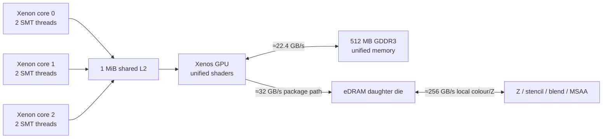
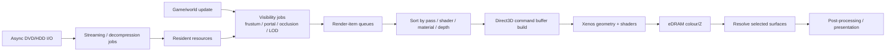

# Xbox 360 Rendering Techniques and Optimisation: Architecture, Engine Design, and Production Practice

## Executive summary

The Xbox 360 was an unusually specialised graphics machine. Its most important constraint was not raw shader throughput in isolation, but the interaction of four architectural facts: a three-core, six-hardware-thread **Xenon** CPU with relatively small caches and in-order execution; a **Xenos** GPU with 48 unified shader ALUs and comparatively flexible shader hardware; only **512 MB of unified GDDR3** shared by CPU and GPU; and a very fast but very small **10 MB eDRAM** render-target store attached to the GPU. The eDRAM supplied roughly **256 GB/s of local colour/depth bandwidth**, while ordinary system memory was about **22.4 GB/s**. ATI's architectural presentation also shows a roughly **32 GB/s GPU↔eDRAM-die path** and a 2×10.8 GB/s CPU/GPU link. citeturn5view0turn5view1turn4view2

That imbalance dictated Xbox 360 rendering strategy. Expensive blending, Z/stencil and MSAA operations could be remarkably cheap *while they remained in eDRAM*, but large render targets, multiple render targets, 64-bit HDR formats, repeated resolves to main memory and naïvely implemented deferred renderers could erase that advantage. Microsoft's own Xbox 360 graphics presentation therefore made **predicated tiling**, explicit resolves, compact render-target formats, direct command-buffer management, hardware-specific HLSL extensions and low-level profiling first-class concepts rather than exotic tricks. [Matt Lee's *Next-Generation Graphics Programming on Xbox 360*](https://www.slideshare.net/slideshow/next-generation-graphics-programming-on-xbox-360/43938178) describes the console API as “Direct3D 9+”: similar to PC Direct3D 9, but direct-to-hardware, without the normal PC driver/HAL layers, and with Xbox-specific APIs. citeturn23view0

The most important optimisation rule is therefore:

> **Optimise the Xbox 360 as a data-movement machine first, a pixel/vertex arithmetic machine second.**

A representative 1280×720 32-bit colour target consumes about **3.52 MiB** at 1× MSAA. Colour plus a 32-bit depth/stencil surface is about **7.03 MiB**. At 2× MSAA that becomes about **14.06 MiB**, and at 4× roughly **28.13 MiB**—already far beyond 10 MiB before considering alignment or additional MRTs. Microsoft's predicated-tiling system existed specifically because 720p with MSAA or multiple render targets did not fit in eDRAM. It recorded the scene once, replayed the command buffer for multiple screen tiles and used hardware predication/screen-space extents to minimise duplicate vertex work. citeturn23view0

Production engines demonstrate the same priorities. **Gears of War 2/UE3** halved the dimensions of its SSAO buffer, packed AO and depth into RG16F so subsequent stages could fetch both together, and reported a **fourfold reduction in Xbox 360 resolve cost** for that buffer. It also explicitly fought texture-cache thrashing from random SSAO offsets. citeturn18view0turn19view0turn20view0 **Frostbite 2** used tile-based deferred shading on Xbox 360 to reduce the overdraw and setup cost associated with many local lights. citeturn27view0turn29search0 **CryEngine 3** used a coverage-buffer occlusion system on Xbox 360/PS3, exploiting the ability to move depth information to CPU-accessible memory. citeturn31search12turn31search10 **Halo 3** moved expensive lighting work offline into spherical-harmonic lightmaps and compact BRDF lookup structures rather than spending ALU and storage on fully dynamic evaluation. citeturn15view0turn16view1turn16view2

On the CPU, the central issue was similar. Xenon's **128-byte cache lines**, 32 KiB L1 instruction and data caches per core, shared 1 MiB L2 and special streaming/prefetch instructions encouraged linear, predictable, SIMD-friendly work. Xbox-specific `xDCBT` could prefetch directly towards a target core's L1 while avoiding pollution of the shared L2; streaming writes were also designed to avoid inappropriate L1 allocation. citeturn21search6turn31search5 Microsoft's multicore guidance stresses that the two hardware threads sharing a Xenon core also share execution and L1 resources; adding the second SMT thread usually offered much less than a second independent core and could even hurt when the threads had incompatible cache behaviour. citeturn32view0

Consequently, a strong general-purpose Xbox 360 renderer should:

1. keep the principal depth/colour working set in eDRAM for as long as practical;
2. minimise the **number and byte size of resolves**, not merely draw calls;
3. use predicated tiling or a deliberately compact G-buffer whenever eDRAM capacity is exceeded;
4. prefer compact 32-bit formats and channel packing to 64/128-bit intermediate surfaces;
5. aggressively exploit hierarchical-Z, front-to-back rendering, frustum/portal/coverage culling and LOD;
6. batch geometry and reuse command buffers where repetition justifies it, while recognising that Xbox 360 state changes were already much cheaper than PC D3D9 state changes;
7. keep shaders coherent across Xenos's groups of 64 work items, exploit vector/scalar co-issue through the compiler, and use handwritten microcode only after PIX identifies a worthwhile hot shader;
8. use worker jobs and explicit affinity across the three physical Xenon cores, with SMT siblings reserved for compatible or latency-heavy work rather than treated as six full CPUs;
9. stream large, contiguous chunks asynchronously, perform endian conversion/resource tiling off the render thread, and use XGraphics-style direct resource setup where appropriate;
10. profile continuously using **PIX GPU/CPU timelines, command-buffer captures and hardware performance counters**. Microsoft's later Gamefest material explicitly recommended complementing PIX with Xbox 360 GPU counter APIs for custom in-game and asset-pipeline instrumentation. [Microsoft's Gamefest GPU-counter download](https://www.microsoft.com/en-us/download/details.aspx?id=28125) remains one of the strongest public primary references. citeturn10search0turn10search3turn23view0

The report below derives these conclusions from architecture documentation first, then cross-checks them against production techniques disclosed by Microsoft, ATI, Bungie, Epic, DICE and Crytek. Where an exact percentage was not published, the expected gain is deliberately described qualitatively rather than assigning a fabricated benchmark.

## Hardware and software architecture

**Xenon CPU.** Microsoft's CPU consisted of three symmetric PowerPC-derived cores at 3.2 GHz, each supporting two hardware threads. The caches used unusually large **128-byte lines**. Public architecture material describes small private L1 caches and a **1 MiB shared L2**, with explicit facilities for streaming workloads intended to prevent transient geometry/animation data from destroying useful cache residency. The processor's relatively simple, in-order nature made memory latency, branch behaviour and instruction scheduling substantially more visible to game programmers than on contemporary out-of-order desktop CPUs. The authoritative overview is Jeffrey Andrews and Nick Baker's IEEE Micro paper, [*Xbox 360 System Architecture*](https://doi.org/10.1109/MM.2006.45), supplemented by Microsoft's/IBM's Hot Chips presentation. citeturn1search10turn21search6turn31search20

The practical cache model was approximately:

- each core: 32 KiB instruction L1 + 32 KiB data L1;
- all caches: 128-byte cache lines;
- one 1 MiB shared L2;
- write/streaming behaviour specifically optimised for producer-style data streams;
- `xDCBT`-style prefetching capable of bringing streaming data towards a selected L1 without unnecessarily filling L2. citeturn21search6turn31search5

This immediately favours structures-of-arrays, compact render items, sequential traversal and jobs processing sizeable contiguous ranges. Pointer-rich scene graphs should normally be converted into flat render/visibility arrays before the performance-critical stage.

```cpp
// Conceptual Xenon-friendly visibility input.
// 128-byte alignment keeps unrelated producer/consumer blocks
// from unnecessarily sharing cache lines.

struct alignas(128) BoundsBlock
{
    float centreX[8];
    float centreY[8];
    float centreZ[8];
    float radius[8];
    // additional SoA data...
};

for (std::size_t i = 0; i < objectCount; i += 8)
{
    PrefetchForWorker(&bounds[i]);     // conceptually xDCBT-like
    CullEightObjectsSIMD(bounds[i]);
}
```

This is pseudocode rather than a literal XDK wrapper: Microsoft's special prefetch primitives were platform/compiler-specific. The underlying rationale—128-byte lines, deliberate streaming support and scarce shared L2—is directly documented in the architecture material. citeturn21search6turn31search5

**Xenos GPU.** ATI's original [Xenos presentation by Michael Doggett](https://fileadmin.cs.lth.se/cs/Personal/Michael_Doggett/talks/unc-xenos-doggett.pdf) is particularly useful because it exposes details that generic “ATI R500” descriptions often obscure. Xenos contained **three shader SIMD groups and 48 unified ALUs** shared dynamically between vertex and pixel work, 16 texture-fetch units and GPU-managed balancing between vertex and pixel loads. Microsoft's presentation states that each ALU could co-issue a float4 and scalar operation under suitable scheduling. citeturn5view2turn4view2turn23view0

Xenos was therefore not simply “a DirectX 9 GPU”. Its shader ISA and feature set exceeded normal SM3-era PC hardware in several ways. The XDK HLSL compiler exposed Xbox extensions for explicit vertex fetching, memory export, tessellation and predicated tiling; developers could also write **GPU microcode** mapping directly onto the hardware. Microsoft's stated recommendation, however, was to start in HLSL and replace selected shaders with microcode only where profiling justified the maintenance cost. citeturn23view0

**eDRAM and the daughter die.** The defining Xenos feature was 10 MB of embedded DRAM next to the colour/Z logic. ATI's diagram reports **256 GB/s** between eDRAM and alpha/Z logic, supporting up to eight pixels per clock and dedicated 2×/4× MSAA operations. The GPU-to-daughter-die connection was roughly 32 GB/s, whereas ordinary GDDR3 system memory delivered about 22.4 GB/s. citeturn5view0turn5view1

The consequence can be quantified directly:

| 1280×720 surface set | 1× | 2× MSAA | 4× MSAA |
|---|---:|---:|---:|
| 32-bit colour only | 3.52 MiB | 7.03 MiB | 14.06 MiB |
| 32-bit colour + 32-bit depth | 7.03 MiB | 14.06 MiB | 28.13 MiB |

These are raw pixel-size calculations; real eDRAM allocation also has layout/alignment constraints. Nevertheless, they explain Microsoft's categorical statement that 720p rendering with MSAA or multiple render targets could require predicated tiling. citeturn23view0turn5view1



The diagram deliberately distinguishes **system bandwidth** from **local eDRAM bandwidth**. Treating “256 GB/s” as general-purpose texture bandwidth would be incorrect; it chiefly describes the render-back-end/eDRAM path. citeturn5view0turn5view1

**Compact formats mattered.** ATI specifically provided a 32-bit compact HDR format with a 7-bit mantissa/3-bit exponent arrangement for RGB, a 0–16 range and MSAA compatibility. The presentation contrasts this with wider fixed/float paths that could run at reduced back-end rate. Xenos also exposed DXN and CTX1-style compressed normal formats and single-channel DXT variants. citeturn5view3turn4view2turn23view0 In a 10 MB eDRAM architecture, format choice was an architectural optimisation: a 32-bit lighting buffer could be the difference between one tile and several.

**Direct3D/XDK.** Calling the Xbox 360 graphics API “DirectX 9.0c” is understandable but technically incomplete. Microsoft's own terminology was **Direct3D 9+ on Xbox 360**: it looked much like PC D3D9 and used HLSL/SM3 concepts, yet it was customised for Xenos, “direct to the metal”, had no normal PC driver/HAL abstraction and exposed console-only operations. It communicated with the GPU through a system-memory **ring command buffer** and supported direct command-buffer playback. citeturn23view0

Important Xbox-specific API families included:

- Direct3D 9+-style drawing, state, surfaces and shaders;
- direct command-buffer recording/playback, including `RunCommandBuffer`-style functionality;
- `BeginVertices`/`EndVertices`-style direct allocation into the command stream rather than `DrawPrimitiveUP`;
- **XGraphics**, which could create or initialise texture/vertex/index resource headers without going through the D3D device and was explicitly advertised as useful to threaded loading code;
- texture tiling and endian-swapping functions for offline/runtime resource preparation;
- Xbox-specific HLSL and optional native GPU microcode;
- **PIX** integration and GPU hardware-counter facilities. citeturn23view0

The licensed **Xbox Development Kit/XDK** contained considerably more documentation and samples than survives publicly. This matters when researching the platform in 2026: leaked XDK distributions should not be treated as legitimate downloadable sources. Public Microsoft conference material, ATI papers and developer presentations are the safer primary record.

## Engine architecture patterns

A mature Xbox 360 engine typically separated **world representation** from a compact, frame-local rendering representation. Bungie's SIGGRAPH 2011 presentation on *Making Game Worlds from Polygon Soup* explicitly discusses the pipeline from content through visibility, spatial connectivity and rendering, including portal-generation work and forward-looking parallelisation of visibility/rendering. Epic's *Gears of War 2* material similarly describes static draw lists, reused visibility tests and work deliberately spread across frames. citeturn27view0turn18view0

A representative architecture was therefore:



The critical distinction is that **visibility, sorting, streaming and resource preparation are CPU jobs**, while a relatively narrow submission phase produces the GPU command stream. XGraphics's ability to initialise resource headers without owning the D3D device was explicitly intended to help threaded resource loading. citeturn23view0

**Physical-core versus SMT scheduling.** Microsoft recommends explicit placement of Xbox 360 software threads and provides an example using `XSetThreadProcessor`. Its multicore guidance warns that two SMT threads on one Xenon core share execution units and L1 caches: typical gains from the second thread were described as roughly **10–20% rather than 100%**, with pathological cache interference capable of reducing total performance. citeturn32view0

A sensible renderer therefore put the three most CPU-intensive independent workloads on separate **physical** cores first, then used sibling hardware threads for compatible auxiliary work. A conceptual schedule might look like:

```text
Physical core A:
    HW thread A0  main/game + final render submission
    HW thread A1  lightweight producer / I/O completion

Physical core B:
    HW thread B0  visibility / animation jobs
    HW thread B1  compatible streaming/decompression jobs

Physical core C:
    HW thread C0  physics / scene update jobs
    HW thread C1  render preparation / particles / secondary jobs
```

This is a pattern, not a universal assignment. Actual engines moved work according to their simulation and latency requirements. Microsoft's preferred general architecture also included worker threads drawing jobs from common queues for better load balancing. citeturn32view0

**Production examples show different answers to the same constraints.** Halo 3's renderer heavily precomputed lighting. Bungie stored diffuse illumination in spherical-harmonic lightmaps and factored its material model so that small lookup tables could represent parts of its Cook–Torrance evaluation efficiently. citeturn15view0turn16view1turn16view2 Gears of War 2 used Unreal Engine 3's mixture of precomputed/static representation, per-character spherical-harmonic “light environments”, conventional forward/deferred techniques and aggressive screen-space optimisation. Static-light updates could be amortised over multiple frames according to visibility, distance and importance. citeturn18view0

Frostbite 2 pushed towards **tiled deferred lighting** to cope with many dynamic lights, while CryEngine 3 developed an extensive deferred-lighting system and a CPU-visible coverage buffer for outdoor visibility. citeturn27view0turn29search0turn31search10 The lesson is not that one architecture “won”; it is that the 360 rewarded engines that carefully separated high-frequency dynamic work from work that could be baked, amortised, culled or reduced in resolution.

## GPU rendering optimisations

**Predicated tiling and eDRAM-aware render-target management.** Microsoft's stock solution to eDRAM overflow was to record the scene and replay it over several eDRAM-sized screen regions. Hardware predication and screen-space extent capture limited rendering to tiles intersected by each primitive. The final tiled surfaces were resolved into a system-memory texture. Microsoft explicitly says that the cost is extra vertex processing for primitives crossing multiple tiles, with no equivalent multiplication of pixel shading when predication rejects irrelevant tiles. citeturn23view0

Conceptually:

```cpp
// Pseudocode, not literal XDK signatures.

RecordCommandBuffer(sceneCommands);

for (Tile tile : ComputeEDRAMTiles(formatSet, msaa))
{
    BindEDRAMTile(tile);

    // Hardware screen-space predication prevents commands whose
    // primitives do not intersect this tile from doing useful work.
    ReplayPredicated(sceneCommands, tile);

    ResolveTileToSystemMemory(tile, finalSurface);
}
```

**Expected impact:** enabling rather than merely incremental. It makes render configurations possible that cannot physically fit in 10 MB. It can also retain eDRAM's very high local Z/blend bandwidth. The penalty is duplicated vertex/setup work, command replay and resolve traffic. Large screen-spanning geometry, particles and fullscreen passes are particularly poor candidates for naïvely replayed tiling. citeturn23view0

The deeper optimisation is to avoid needing more tiles in the first place. Pack G-buffer channels, use compact HDR formats, discard transient surfaces as soon as possible and resolve only data that will actually be sampled later. Render-target lifetime analysis mattered on Xbox 360 years before modern “frame graph” terminology became common.

**Minimise resolves.** A resolve crosses the boundary between the tiny, extremely fast eDRAM render store and ordinary system memory. Epic's SSAO implementation is an unusually clean production measurement. Its baseline was 720p with 16 occlusion samples and 20 filter samples. Epic moved AO to half width and half height, stored depth alongside AO in an RG16F target, reused that representation in subsequent passes and reported that the downsampled configuration reduced **Xbox 360 resolve cost by a factor of four**. citeturn18view0turn20view0

Normalised resolve component:

```text
Full-resolution SSAO target      ████████████████  1.00
½ width × ½ height target        ████              0.25
```

This is a measured statement about the **resolve component**, not a claim that the whole SSAO algorithm became four times faster. citeturn20view0

A general pattern is therefore:

```cpp
// Pack values consumed together.
half2 aoDepth = half2(ambientOcclusion, linearDepth);
WriteHalfResolutionRG16F(pixel / 2, aoDepth);

// Later filter:
half2 sample = AOAndDepth.Sample(...);
FilterUsingBoth(sample.x, sample.y);
```

Pitfalls include haloing at depth discontinuities, loss of thin geometry and reconstruction artefacts. Epic selected the **furthest source depth** while downsampling to reduce silhouette errors and added temporal filtering to recover quality lost by cheaper spatial sampling. citeturn19view1turn18view0

**MSAA strategy.** Xenos's eDRAM die was expressly designed for 2×/4× MSAA alongside Z/stencil and blending. Microsoft's presentation went so far as to describe these back-end operations as effectively “free” in combination; this should be read as **local back-end throughput**, not “zero frame-time cost”. MSAA consumes eDRAM capacity, can force additional tiles, enlarges resolves and can make shader-side per-sample work expensive. citeturn5view1turn23view0

For a forward renderer with a compact colour/depth set, hardware MSAA was attractive. For MRT-heavy deferred renderers, **2× rather than 4×**, lower internal resolution, deferred lighting with special edge handling, or post-process anti-aliasing could be better because they avoided multiplying a large G-buffer. The right decision should be made from *tile count and resolve bytes*, not from ROP throughput alone.

**Tiled deferred lighting.** The SIGGRAPH 2011 Frostbite presentation explicitly lists **“Tiled-Based Deferred Shading on Xbox 360”** among the techniques used by Battlefield 3/Need for Speed: The Run, with the motivation of enabling richer dynamic lighting while reducing the costs of conventional deferred-light-volume rendering. [The official SIGGRAPH course page](https://advances.realtimerendering.com/s2011/index.html) supplies the original slide deck. citeturn27view0turn29search0

On an SM3-era console without modern compute shaders, the conceptual implementation is:

```cpp
// CPU side
for (Light& light : visibleLights)
    BinLightIntoScreenTiles(light, tileLists);

for (ScreenTile& tile : tiles)
{
    if (tile.lights.empty())
        continue;

    SetScissor(tile.rect);

    for (auto batch : PackLightsForShaderConstants(tile.lights))
    {
        SetLightConstants(batch);
        DrawDeferredLightingQuad(tile.rect);
    }
}
```

The win is that G-buffer data is read and written for a **bounded screen region**, and multiple lights can be evaluated during one shading invocation instead of repeatedly rendering overlapping full light volumes. It primarily addresses pixel overdraw, ROP traffic and per-light draw/setup cost. citeturn27view0turn29search0

Pitfalls are CPU light binning, shader permutation/register pressure and tiles containing many lights. Extremely large lights hit many tiles and behave like global lights; they should usually have a separate path.

**Hierarchical-Z and light-volume rejection.** Xenos had dedicated hierarchical-Z support. DICE/EA disclosed a particularly hardware-specific trick called **reverse Hi-Z reload** on Xbox 360: alias a render target over the depth storage, initialise the hierarchical representation in the reversed sense, then render the back faces of convex light volumes so pixels beyond the light boundary are conservatively rejected before expensive shading. citeturn29search2

The broader principle is more portable:

```cpp
DepthPrepassOrOpaquePass();

for (LightVolume l : lights)
{
    ConfigureDepthAndHiZForVolume(l);
    DrawBackOrFrontFacesAsAppropriate(l);
}
```

**Expected gain:** potentially high when deferred light volumes cover much of the screen but only a fraction of their pixels can contribute. **Pitfall:** a depth-only/prepass itself costs vertex processing and eDRAM traffic. On geometry-heavy scenes with cheap shaders, an unconditional prepass can lose.

**Shader ALU and branch optimisation.** Xenos's unified ALUs could co-issue vector and scalar operations, while shader work was scheduled over groups of **64 vertices/pixels**. Microsoft's key warning was that dynamic branches are attractive only when the group largely takes the same path; coherent branches can approach static-branch efficiency, divergent branches waste execution. citeturn23view0

Hence prefer:

```hlsl
// Arrange calculations so a vector operation and an independent
// scalar calculation are available to the compiler.
float4 packedTerm = a * b + c;
float  ndotl      = saturate(dot(N, L));

// Branch on spatially coherent conditions when possible:
if (tileHasShadow) {
    shadow = SampleShadow(...);
}
```

over branches driven by high-frequency noise or arbitrary material masks. Actual co-issue is a property of compiled microcode, not HLSL syntax, so **inspect the compiled shader in PIX** rather than counting source-level arithmetic. PIX could display/debug both HLSL and microcode. citeturn23view0

**Texture-cache optimisation.** Gears 2 gives a production example: Epic identified random per-pixel SSAO offsets as causing **texture-cache thrashing** and clamped the offset radius in screen space. citeturn19view0turn18view0 This is a more useful Xenos optimisation lesson than generic “reduce texture fetches”: preserve locality.

```hlsl
float2 offset = randomVector * min(worldRadiusToPixels, MAX_SCREEN_RADIUS);
float depth = depthTex.Sample(samplerState, uv + offset * invResolution).r;
```

For normals/material auxiliaries, compressed DXN/CTX1-style formats also reduce memory footprint and texture traffic. ATI specifically highlighted these formats in Xenos documentation. citeturn4view2turn23view0

**Precompute and LUT expensive BRDF work.** Halo 3 decomposed lighting into precomputable components, represented diffuse lighting through SH lightmaps and used compact two-dimensional LUTs to make Cook–Torrance-style material evaluation practical without large per-material storage. Bungie's paper includes actual HLSL appendices for both SH diffuse and Cook–Torrance evaluation. [Original Halo 3 SIGGRAPH slides](https://advances.realtimerendering.com/s2008/SIGGRAPH-Lighting%20of%20Halo%203.pdf). citeturn15view0turn16view1turn16view2

```hlsl
// Conceptual factorisation
float diffuse = EvaluateSH(lightmapCoefficients, normal);
float2 brdfUV = float2(ndotv, roughness);
float specularFactor = brdfLUT.Sample(linearSampler, brdfUV).r;

return albedo * diffuse + specularFactor * specularLighting;
```

Expected impact is high where complex lighting would otherwise run on every visible pixel. Pitfalls are bake complexity, reduced support for fully dynamic illumination and LUT approximation error.

**Draw-call batching, state sorting and command buffers.** Xbox 360 needs a nuance often lost in modern retrospective advice: Microsoft explicitly says changing shaders/render state could be relatively inexpensive because Xenos supported multiple contexts and Direct3D used **lazy, batched state blocks** with low-overhead CPU instructions. It was not the same driver-heavy D3D9 cost model as Windows. citeturn23view0

Therefore, sorting everything purely to minimise state changes can be counterproductive if it destroys front-to-back ordering or increases overdraw. The more precise target is:

- reduce redundant API calls and command-buffer bytes;
- batch tiny draw calls;
- reuse recorded command buffers for repeated static work;
- preserve depth-efficient ordering where pixel cost dominates.

```cpp
Sort(renderItems,
     [](const Item& a, const Item& b) {
         // Pass first; then broad material bucket;
         // preserve approximate front-to-back depth within opaque bucket.
         return MakeKey(a.pass, a.materialClass, a.depthBucket) <
                MakeKey(b.pass, b.materialClass, b.depthBucket);
     });
```

**Command-buffer reuse.** Direct command-buffer playback was a documented Xbox feature, and `RunCommandBuffer` supported modifying/replaying prebuilt buffers. citeturn23view0 Static shadow casters, repeated environmental chunks or templated particle batches could amortise CPU command construction. The pitfall is invalidation: per-object constants, addresses and dynamic resources must either be patchable or excluded from the reusable portion.

**Instancing.** Microsoft's deck says PC D3D9's `SetStreamSourceFrequency` path was **not directly supported in the same way** on Xbox 360, but equivalent and more flexible arrangements could be implemented in the vertex shader using Xbox's explicit vertex-fetch/index facilities. Xenos also supported texture-array-like structures useful for repeated/instanced assets. citeturn23view0turn4view2

```hlsl
// Conceptual Xbox-style explicit-instance fetch
uint instance = GetInstanceIndex();
float4x3 world = FetchInstanceTransform(instance);

Vertex v = FetchMeshVertex(vertexIndex);
output.position = mul(float4(v.position, 1), worldViewProj(instance));
```

Expected gain is high in draw-call-limited vegetation, crowds, debris and repeated props. Pitfalls are large per-instance payloads, divergent material selection and reduced culling granularity if too many unrelated instances are packed together.

**GPU microcode.** The XDK allowed shaders to be written in a representation mapping 1:1 to Xenos hardware. Microsoft's recommendation was explicit: **use HLSL normally; use microcode on individual shaders only when performance analysis warrants it**. citeturn23view0

That advice is still sound. Hand-written microcode can improve instruction pairing, register use or exploit a hardware idiom the compiler misses, but creates large maintenance and correctness costs and permanently binds the shader to Xenos. Expected gain ranges from zero to substantial on a pathological hot shader; there is no defensible platform-wide percentage.

## CPU, visibility, memory, streaming and I/O optimisations

**Frustum culling.** This is the cheapest visibility stage and should operate on compact, cache-friendly bounds before render-item creation.

```cpp
for (ObjectRange range : ranges)
{
    Prefetch(range.next);

    uint visibleMask = FrustumTestSIMD(range.bounds);
    EmitVisibleObjects(range, visibleMask, visibleQueue);
}
```

The hardware rationale is less about GPU geometry throughput than avoiding unnecessary CPU scene traversal, command generation, vertex fetch and shader work simultaneously. Because Xenon used 128-byte cache lines and small L1s, the visibility database should normally be compact and sequential rather than pointer-chasing through gameplay objects. citeturn21search6turn31search5

**Portal/PVS culling.** Portals remain very effective for rooms, corridors and other strongly connected indoor topology. Bungie and Umbra's SIGGRAPH presentation focused specifically on **visibility, spatial connectivity and automatic portal generation**, showing that this remained a production issue on Xbox 360 rather than an obsolete 1990s technique. citeturn27view0

```cpp
VisitCell(camera.cell);

void VisitCell(Cell c)
{
    DrawVisibleObjects(c);

    for (Portal p : c.portals)
        if (PortalIntersectsCurrentFrustum(p))
            VisitCellWithClippedFrustum(p.otherCell, p);
}
```

Expected gain can be extremely high in indoor environments because entire rooms disappear from all later stages. The principal pitfalls are dynamic geometry, open outdoor worlds, portal authoring/generation and conservative handling of doorways.

**Coverage-buffer/software occlusion.** CryEngine 3 used a low-resolution coverage/depth representation as a main outdoor occlusion mechanism. CryEngine's documentation notes that on hardware including Xbox 360 and PS3 the Z-buffer could efficiently be copied into main memory for coverage testing. citeturn31search12turn31search10

The usual pattern is one-frame-delayed and conservative:

```cpp
// GPU, previous frame
DownsampleDepthConservatively(previousDepth, smallDepth);

// CPU worker, current frame
for (Object& obj : candidates)
{
    Rect r;
    float nearestDepth;
    ProjectBounds(obj.bounds, r, nearestDepth);

    if (!ConservativeDepthTest(smallDepth, r, nearestDepth))
        visible.push_back(&obj);
}
```

Expected impact is high in dense outdoor environments because rejected objects save CPU submission, vertex processing and pixel shading together. Pitfalls are GPU→CPU latency, camera movement, holes in the coarse buffer and false occlusion. A production system must bias toward **false visible**, never false invisible.

**LOD.** The best Xbox 360 LOD systems reduce more than triangle count. A useful LOD transition simultaneously simplifies geometry, shaders, shadow casting, material layers, animation and texture residency.

```cpp
float projected = ProjectedScreenRadius(bounds, camera);

LOD desired =
    projected > L0 ? HIGH :
    projected > L1 ? MEDIUM :
                     LOW;

object.lod = ApplyHysteresis(object.lod, desired);
```

The expected gain is content-dependent but potentially high because it attacks vertex ALU, fetch bandwidth, texture working set, overdraw and streaming memory at once. This conclusion follows directly from the combination of 512 MB unified memory, finite system bandwidth and Xenon's small cache hierarchy. citeturn5view0turn21search6 Use hysteresis or temporal stability to prevent visible “LOD chatter”.

**Multicore render preparation.** Microsoft's Xbox-specific multicore article recommends explicit processor affinity and common work queues. It also cautions against equating six hardware threads with six independent cores. citeturn32view0

A practical job graph is:

```cpp
jobs.Add(BuildAnimationPalettes);
jobs.Add(UpdateParticleBounds);
jobs.Add(FrustumCull);
jobs.Add(OcclusionTest);
jobs.Add(BuildShadowCasterLists);
jobs.Add(BinLightsToTiles);
jobs.RunOnWorkers();

jobs.Wait(RenderPreparationFence);

BuildAndSubmitCommandBuffer();
```

Expected gain approaches the degree to which these jobs were formerly serial, but SMT scaling is much smaller than physical-core scaling. Jobs sharing an SMT core should preferably have different bottlenecks but compatible cache footprints—for example, a partly latency-bound loader paired with arithmetic work can make more sense than two cache-saturating visibility traversals. citeturn32view0

**False-sharing and cache-line ownership.** Because a cache line is 128 bytes, two tiny queues/counters modified by different cores can cause unnecessary coherence traffic if they share a line. citeturn21search6

```cpp
struct alignas(128) WorkerQueueState
{
    std::atomic<uint32_t> readIndex;
    char pad[124];
};

struct alignas(128) ProducerState
{
    std::atomic<uint32_t> writeIndex;
    char pad[124];
};
```

Padding everything this way would waste memory; reserve it for genuinely hot cross-core write locations.

**Streaming and DVD/HDD I/O.** Open-world Xbox 360 games could not assume an installed hard disk, so optical-drive seek behaviour had to influence content layout. Volition's GDC presentation on *The Creation of Saints Row's Open World Cityscape* explicitly identifies **DVD seek time** as a major risk and explains its use of **chunk streaming**: load large sets of nearby objects together rather than issue many fine-grained seeks. It also documents Xbox 360-specific texture-memory padding problems. [Original GDC slide deck](https://media.gdcvault.com/gdc07/slides/S3741i1.pdf). citeturn33search8

The general streaming pipeline is therefore:

```cpp
// I/O thread
IssueAsyncRead(chunk.fileOffset,
               chunk.compressedBytes,
               alignedStagingBuffer);

// Worker after completion
Decompress(chunk);
EndianSwapIfRequired(chunk);
ConvertOrTileTextures(chunk);
InitialiseResourceHeaders(chunk); // XGraphics-style
PublishResidentChunk(chunk);
```

Microsoft's XGraphics API was explicitly designed to let resource headers be created/updated outside the D3D device and was called out as useful for **threaded loading**. citeturn23view0

The platform's publicly documented architecture does **not** justify treating Xbox 360 like PS3 with a freely programmable SPU/DMA subsystem. A better model is asynchronous bulk I/O plus CPU worker preparation into unified memory. Do not block the rendering thread on small file reads.

Sector-friendly layouts are also sensible. Microsoft's later XACT/DirectX tooling documentation notes that streaming wave-bank layouts traditionally used **2,048-byte alignment consistent with DVD sectors** and non-buffered asynchronous I/O. Although that document is audio-oriented rather than a graphics-XDK specification, it illustrates the same optical-media design principle. citeturn33search9

**Texture/resource layout.** Offline preparation is preferable to spending Xenon time converting every asset at load. XGraphics included texture tiling and endian-swapping routines and a Windows library suitable for offline resource packing. citeturn23view0 A production asset cooker should therefore emit console-native texture layouts, already compressed into DXN/DXT/CTX1-class formats where suitable, with large streamed chunks ordered by expected access locality.

**CPU→GPU producer patterns.** Keep dynamic vertex/instance/constant data in linear ring buffers. Allocate once per frame or per producer range and advance monotonically:

```cpp
DynamicAllocation a =
    dynamicRing.Allocate(bytes, /*alignment=*/128);

BuildInstancesSIMD(a.cpuPtr, visibleInstances);

// The GPU references the same unified-memory allocation later.
SubmitDraw(a.gpuAddress, count);
```

The point is to avoid per-object heap churn and improve CPU cache/store behaviour; exact XDK resource flags and cache modes depend on the licensed SDK.

## Profiling, code, samples and repositories

The most important profiling tool was **PIX for Xbox 360**. Microsoft's graphics deck describes a performance monitor plus CPU timeline, GPU timeline, command-buffer capture/playback/analysis, mesh debugging and vertex/pixel shader debugging. Development hardware exposed extensive GPU performance counters specifically to PIX. Named events could be inserted into the application so engine subsystems appeared in captures. citeturn23view0turn8search13

A productive optimisation loop is therefore:

```cpp
PIXBeginNamedEvent(..., "Opaque");
// opaque rendering
PIXEndNamedEvent();

PIXBeginNamedEvent(..., "Lighting");
// lighting
PIXEndNamedEvent();

PIXBeginNamedEvent(..., "Post");
// post-processing
PIXEndNamedEvent();
```

Then ask, in order:

1. Is the frame CPU- or GPU-bound?
2. If GPU-bound, is the bottleneck vertex work, pixel ALU, texture fetch, eDRAM/back-end activity or resolves/system-memory traffic?
3. If CPU-bound, is time in gameplay, visibility, animation, API submission, synchronisation or streaming?
4. Which change moves the counter that corresponds to the suspected bottleneck?
5. Did frame time improve on representative gameplay, rather than merely in the captured test case?

Microsoft's [*Measuring the Immeasurable: Using Xbox 360 GPU Performance Counters for Fun and Profit*](https://www.microsoft.com/en-us/download/details.aspx?id=28125) goes further, describing the Direct3D performance-counter APIs as a way to build title-specific overlays and asset-pipeline tests in addition to conventional PIX investigation. citeturn10search0turn10search3

**High-value original presentations and papers.**

The starting set I would preserve locally for serious Xbox 360 renderer work is:

| Material | Why it matters | Availability / licence note |
|---|---|---|
| Andrews & Baker, *Xbox 360 System Architecture*, IEEE Micro 2006 | CPU/GPU/memory/cache architectural foundation | [DOI](https://doi.org/10.1109/MM.2006.45); IEEE copyright. citeturn1search10 |
| Michael Doggett/ATI, *Xenos: XBOX360 GPU* | Xenos SIMD, texture system, eDRAM, bandwidth, formats | [PDF](https://fileadmin.cs.lth.se/cs/Personal/Michael_Doggett/talks/unc-xenos-doggett.pdf); presentation material, not reusable source-code licence. citeturn4view2turn5view0 |
| Matt Lee/Microsoft, *Next-Generation Graphics Programming on Xbox 360* | Best public overview of D3D9+, command buffers, tiling, HLSL/microcode, PIX and XGraphics | [Archived presentation copy](https://www.slideshare.net/slideshow/next-generation-graphics-programming-on-xbox-360/43938178); Microsoft presentation copyright. citeturn23view0 |
| Epic, *Rendering Techniques in Gears of War 2* | Production console optimisations; SSAO cache locality, half-res targets, temporal filtering | [Epic PDF](https://cdn2.unrealengine.com/Resources/files/GDC09_Smedberg_RenderingTechniques-1415210295.pdf); Epic presentation copyright. citeturn18view0turn20view0 |
| Bungie, *Lighting and Material of Halo 3* | Actual HLSL, SH lightmaps, BRDF factoring/LUTs | [SIGGRAPH PDF](https://advances.realtimerendering.com/s2008/SIGGRAPH-Lighting%20of%20Halo%203.pdf); educational reference, not a general source licence. citeturn15view0 |
| DICE/EA, *Five Rendering Ideas from Battlefield 3 and Need for Speed: The Run* | Xbox 360 tiled deferred shading, reverse Hi-Z and other production tricks | [SIGGRAPH 2011 course page](https://advances.realtimerendering.com/s2011/index.html); EA/authors' presentation material. citeturn27view0turn29search0 |
| Bungie/Umbra, *Making Game Worlds from Polygon Soup* | Visibility, spatial hierarchy, portals and parallel rendering | Downloadable from the same [SIGGRAPH 2011 page](https://advances.realtimerendering.com/s2011/index.html). citeturn27view0 |
| Crytek, *Secrets of CryENGINE 3 Graphics Technology* | Deferred-lighting optimisation and coverage-buffer visibility | Original slides/videos are linked by the [SIGGRAPH 2011 course](https://advances.realtimerendering.com/s2011/index.html). citeturn27view0turn31search10 |
| Volition, *The Creation of Saints Row's Open World Cityscape* | DVD-seek-aware chunk streaming and console memory lessons | [GDC PDF](https://media.gdcvault.com/gdc07/slides/S3741i1.pdf). citeturn33search8 |
| Microsoft Gamefest, GPU performance counters | Hardware-counter-driven bottleneck analysis | [Official Microsoft download](https://www.microsoft.com/en-us/download/details.aspx?id=28125). citeturn10search0 |

**An unusually useful XDK sample reference.** Colin Barré-Brisebois's publication archive records an **“XBOX 360 SDK Sample 2011: Fast Separable Grayscale Blur”**, co-authored with Microsoft's Ivan Nevraev and shipped in the August 2011 XDK. It describes aliasing an 8-bit buffer as 32-bit to reduce separable low-pass-filter cost by at least a factor of four. [Author's publication index](https://colinbarrebrisebois.com/publications/). citeturn25search2 The important licensing caveat is that this was an **XDK sample**, not an independently open-source repository; obtaining it from an unauthorised SDK mirror is not equivalent to having redistribution rights.

**Open-source and legally public reference code.** Production Xbox 360 render back-ends for Unreal Engine 3, Frostbite 2, Halo and the period CryEngine were proprietary, so there is no honest public repository containing the exact code behind most of the techniques above. Three public alternatives are useful for different purposes:

**Xenia.** [xenia-project/xenia](https://github.com/xenia-project/xenia) is an open-source Xbox 360 emulator/research project and contains modern code modelling Xenos command processing, render targets, resolves, shaders and texture formats. Xenia is BSD-licensed; check the repository's current `LICENSE` before integrating code. It is excellent for understanding hardware semantics but **not** evidence of how a shipping 2005–2013 game engine structured its renderer. citeturn31search29

**Free60 / libXenon.** [Free60](https://free60.org/) provides documentation, a toolchain and libXenon/homebrew examples, including Xenos framebuffer material. It is valuable for low-level experimentation without the proprietary XDK. Licensing is component-specific, so the Free60 wiki should not be interpreted as granting one blanket licence over everything it links. citeturn32view2

**Open Xbox-360-targeting ports.** Public repositories such as `snes360-enhanced` contain Xbox 360 Visual Studio/XDK project files and an HLSL directory, providing examples of real platform conditionals and D3D paths. The repository explicitly targets an Xbox 360 XDK toolchain. Its codebase combines Snes9x and multiple bundled dependencies, so reuse requires checking each component's licence rather than assuming a permissive licence for the entire tree. citeturn33search4turn33search1

**XNAMath.** Microsoft's Xbox-era **XNAMath** is another useful public artefact. Chuck Walbourn notes that XNAMath 2.05 was included in the July 2012 Xbox 360 XDK and made available to Windows developers; its later public distribution uses an MIT licence. It is useful for studying SIMD-friendly matrix/vector and bounding-volume code even though it is not a renderer. citeturn33search0

For research, these open projects should be kept conceptually separate from the licensed XDK: Xenia/Free60 tell us a great deal about the machine; Microsoft/ATI/XDK presentations tell us how Microsoft expected authorised titles to program it; GDC/SIGGRAPH talks tell us what production engines actually chose.

## Comparative assessment and implementation guidance

The table below uses **expected gain** rather than invented percentages. “High” means the optimisation can change frame feasibility or remove milliseconds when its associated bottleneck dominates; it does not mean every title will realise the same benefit.

| Technique | Hardware constraint addressed | Complexity | Expected gain | References |
|---|---|---:|---|---|
| Predicated eDRAM tiling | 10 MB eDRAM cannot hold many 720p MSAA/MRT configurations | High | **Enabling / high**; necessary for otherwise impossible RT sets, at extra vertex/replay cost | Microsoft Xbox 360 D3D talk. citeturn23view0 |
| Compact eDRAM formats / packed G-buffer | eDRAM capacity, resolve bytes, system bandwidth | Medium | **High** when it reduces tile count or resolves | ATI Xenos formats; Epic RG16F AO+depth. citeturn5view3turn20view0 |
| Half-resolution post effects | Resolve bandwidth, pixel ALU and texture bandwidth | Low–Medium | **High** for low-frequency effects; Gears SSAO resolve cost fell 4× | Epic GDC 2009. citeturn20view0 |
| 2×/4× hardware MSAA | Edge quality while exploiting eDRAM ROP bandwidth | Medium | **Very efficient back-end AA**, but capacity/tile cost can dominate | ATI/Microsoft Xenos presentations. citeturn5view1turn23view0 |
| Tiled deferred lighting | Deferred-light overdraw, G-buffer bandwidth, many local-light draws | High | **High** with numerous overlapping local lights | DICE/EA SIGGRAPH 2011. citeturn27view0turn29search0 |
| Hi-Z / reverse Hi-Z light rejection | Wasted pixel shading of light volumes | High | **Medium–high** when light volumes cover much hidden space | DICE/EA. citeturn29search2 |
| Front-to-back/depth prepass | Expensive hidden pixel shading | Low–Medium | **Conditional**; high with heavy PS overdraw, negative if geometry-bound | Xenos Hi-Z architecture. citeturn23view0 |
| Shader vector/scalar co-issue | 48-ALU shader throughput | High tuning effort | **Medium** on ALU-bound hot shaders | Microsoft Xenos shader description. citeturn23view0 |
| Coherent shader branching | 64-work-item execution groups | Medium | **Medium–high** where a costly coherent path can be skipped | Microsoft shader guidance. citeturn23view0 |
| Texture-access locality | Xenos texture cache, system-memory bandwidth | Medium | **Medium–high** in sampling-heavy passes | Gears SSAO cache-thrash case. citeturn19view0 |
| SH/LUT/precomputed lighting | Pixel ALU, dynamic-light cost, storage | High offline/tool complexity | **High** for static/semi-static lighting | Halo 3. citeturn15view0turn16view1 |
| Draw batching and render sorting | Xenon API/submission work and command-buffer volume | Medium | **Medium**, sometimes high for tiny draws | Xbox D3D direct command-buffer architecture. citeturn23view0 |
| Reusable command buffers | CPU command construction | High | **Medium–high** for static/repeated geometry | Microsoft D3D 9+. citeturn23view0 |
| Shader-driven instancing | Draw-call count / repeated geometry | Medium–High | **High** for foliage/crowds/debris | Xbox vertex-fetch path. citeturn23view0turn4view2 |
| Frustum + portal culling | CPU submission, vertex and pixel work | Medium | **High** in structured worlds | Bungie/Umbra SIGGRAPH. citeturn27view0 |
| Coverage-buffer occlusion | Outdoor hidden-object processing | High | **High** in dense occluded scenes | CryEngine 3. citeturn31search10turn31search12 |
| Multi-dimensional LOD | Geometry, shaders, textures, memory and streaming | Medium–High | **High**, strongly content dependent | Inference from memory/bandwidth constraints. citeturn5view0turn21search6 |
| Xenon job system / physical-core parallelism | In-order CPU throughput | High | **High** versus serial preparation | Microsoft multicore guidance. citeturn32view0 |
| SMT-aware scheduling | Shared execution units/L1 per core | Medium | Usually **modest positive**, potentially negative if poorly paired | Microsoft says typical sibling-thread gain only ~10–20%. citeturn32view0 |
| 128-byte-aligned/linear data | 128-byte cache lines, small L1/shared L2 | Medium | **Medium–high** in traversal/animation/render preparation | Xbox architecture material. citeturn21search6turn31search5 |
| `xDCBT`/stream-aware prefetch | L2 pollution and read latency | High/platform-specific | **Medium–high** for predictable streams | Xbox CPU architecture. citeturn31search5turn21search6 |
| Async large-chunk streaming | 12× DVD seeks, 512 MB working set | High | **Enabling / high** for open worlds | Saints Row GDC; Xbox system architecture. citeturn33search8turn23view0 |
| Threaded XGraphics resource preparation | Loader stalls and render-thread contention | Medium | **Medium–high** during streaming | Microsoft XGraphics guidance. citeturn23view0 |
| Handwritten Xenos microcode | HLSL compiler misses in isolated hot shaders | Very high | **Low to high**, entirely shader-specific | Microsoft recommends profile-first use. citeturn23view0 |
| PIX + hardware counters | Unknown bottlenecks / misleading intuition | Low | **Foundational**; makes every other optimisation evidence-driven | Microsoft PIX and Gamefest material. citeturn23view0turn10search0 |

For a general-purpose renderer with no fixed genre or frame-rate target, I would implement the platform in the following order.

**First, establish the eDRAM budget before writing effects.** For every pass record colour/depth formats, MSAA level, MRT count, eDRAM footprint, number of predicted tiles and bytes resolved to main memory. This catches pathological deferred/HDR configurations earlier than shader optimisation ever will. Xenos's architecture makes this the closest equivalent to a modern transient-resource/frame-graph budget. citeturn5view1turn23view0

**Second, build a frame around depth and visibility.** Frustum cull first, portal/PVS where world topology supports it, coverage/occlusion cull where it does not, then screen-size LOD. Within opaque rendering, favour enough front-to-back coherence for hierarchical Z to remove expensive hidden pixels. citeturn27view0turn31search12turn23view0

**Third, make render targets scarce by design.** A new full-resolution surface on Xbox 360 is not “just another texture”. Ask whether an effect can be quarter/half resolution, packed into an existing target, recomputed, temporally accumulated or represented in 32 rather than 64 bits. Gears 2's half-resolution SSAO is the canonical demonstration: one apparently mundane format/resolution decision directly cut its resolve cost by four. citeturn20view0

**Fourth, choose the lighting architecture from expected light density.** Sparse lights and materials that benefit from conventional MSAA fit a forward path well. A scene with many overlapping local lights favours deferred/tiled methods, but the G-buffer must be designed around 10 MB eDRAM rather than copied from a PC renderer. Frostbite's tiled-deferred work is particularly relevant here. citeturn27view0turn29search0

**Fifth, parallelise producer work, not arbitrary code.** Visibility, animation palette generation, particles, shadow lists, light binning, decompression and resource conversion naturally produce arrays consumed later by rendering. They are good job-system candidates. Avoid placing two equally cache-hungry, CPU-saturating jobs on sibling hardware threads and expecting 2× performance; Microsoft's own guidance specifically warns against that interpretation of SMT. citeturn32view0

**Sixth, make the asset pipeline part of the optimisation.** Ship textures already compressed/tiled/endian-correct where practical, cluster streamed data spatially to avoid DVD seeks, produce platform-specific LODs and precompute lighting/material data that does not need to be dynamic. Halo 3, Saints Row and Microsoft's XGraphics interfaces all show that production performance depended as much on cooked data as runtime code. citeturn15view0turn33search8turn23view0

**Finally, optimise shaders and command submission from PIX evidence.** Xenos offered extraordinary low-level control—including microcode—but that was a reason to profile carefully, not a reason to start in assembly. Microsoft's own guidance was HLSL first, microcode selectively. Likewise, state changes were already far cheaper than on desktop D3D9; blindly sorting solely by material can sacrifice overdraw performance for a CPU saving that does not exist. citeturn23view0

That combination—**eDRAM-first render-target design, aggressive visibility/LOD, compact and locality-friendly data, asynchronous chunk streaming, physical-core-aware job scheduling, direct command submission and PIX-driven shader tuning**—is the recurring pattern across the best-documented Xbox 360 engines. It is also why the console is still a useful rendering-architecture case study: it forced developers to reason explicitly about where every intermediate image lived, how many times it moved, which processor touched it and whether the visual benefit justified crossing a bandwidth or cache boundary. citeturn1search10turn23view0turn20view0turn27view0